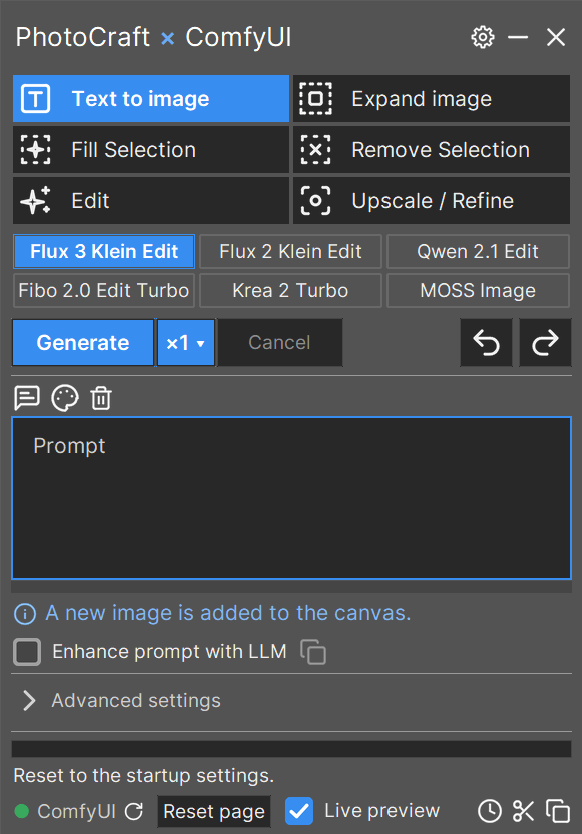

<div align="center">

# PhotoCraft AI

**Photoshop-style generative AI for PhotoCraft, running on your own PC.**
Pick a function, type a prompt, press Generate: the result arrives as a new layer in your document.

*New to AI image tools? No problem: this page explains every step and every term. You do not need to know anything about AI or programming.*



Tested: Windows 11 · 16 GB VRAM · PhotoCraft 0.21.0 · ComfyUI version: 0.42.0 

[Quick start](#quick-start) · [Install on Windows](#install-on-windows) · [Install on Linux](#install-on-linux) · [First start](#first-start) · [Model downloads](#model-downloads) · [Functions](#functions) · [Help](#help) · [Technical details](#technical-details) · [Licences](#licences-of-the-models)

</div>

---

- **Six function buttons:** Text to image, Expand, Fill, Remove, Edit and Upscale / Refine. Edit has three tabs under the prompt: Edit canvas, Multi image edit and (Flux 3 only) BBOX placement.
- **Six models:** Flux 3 Klein, Flux 2 Klein, Qwen Image 2.1, Fibo 2.0 Edit Turbo, Krea 2 Turbo and MOSS Image.
- **Local:** the models run in ComfyUI on your own graphics card.

> Unofficial community project, not affiliated with PhotoCraft, ArtCraft or Storyteller. PhotoCraft is in early alpha
> and so is this plugin. "PhotoCraft AI" is a working title.

## Quick start

**What you need first** (all free):

- **[PhotoCraft](https://github.com/storytold/photocraft/releases)**: the image editor where you work. The plugin adds AI functions to it.
- **[ComfyUI](https://github.com/comfyanonymous/ComfyUI#installing)**: the program that runs the AI models on your graphics card. Install it, start it once, and leave it running while you work.
- **An NVIDIA graphics card with 16 GB of VRAM** (VRAM is the memory of the graphics card; you can look it up in the Task Manager under Performance ▸ GPU). Released and tested on 16 GB.
- **[Python](https://www.python.org/downloads/windows/) 3.11 or newer** (a free programming language the plugin is written in; the setup script uses it, you never have to write any code).
- **About 15 to 20 GB of free disk space per model you want to use** (the models are large files; one model is enough to start).
- **A custom node pack, only for Upscale with Flux 3 (and the tiles option with Fibo):** [ComfyUI-KJNodes](https://github.com/kijai/ComfyUI-KJNodes) (a small add-on for ComfyUI; install it from the ComfyUI Manager or from the link). Everything else works without it. Details: [Model downloads](#model-downloads).

**Windows**

1. Click **Code ▸ Download ZIP** (green button at the top of this page) and unpack it to a folder you keep, for example `C:\Tools\photocraft-ai`.
2. Double-click **`setup-windows.bat`**. It sets everything up and puts **PhotoCraft AI** on your desktop.
3. Start ComfyUI, close PhotoCraft, then double-click **PhotoCraft AI** on your desktop. PhotoCraft opens and the plugin window appears next to it.
4. In the plugin window click the gear ▸ pick a model tab (for example **Qwen Image 2.1**, which needs no login) ▸ **Download all model files**, then restart ComfyUI. (You can also download the files by hand: see [Model downloads](#model-downloads).)
5. Pick a function and a model, type a prompt and press **Generate** (Ctrl+Enter).

**Linux** (Debian/Ubuntu; other distributions: [Install on Linux](#install-on-linux))

```bash
sudo apt install python3 python3-tk python3-venv
git clone <this repository> && cd <this repository>
./setup-linux.sh
```

Then do steps 3 to 5 above, starting **PhotoCraft AI** from your application menu.

## How it fits together

```
PhotoCraft  <-->  this plugin (a small window)  <-->  ComfyUI (your graphics card)
```

- **PhotoCraft** is the image editor where you work and where the results land as layers.
- **ComfyUI** runs the AI models on your graphics card.
- **This plugin** sits between them: it sends your picture or selection to ComfyUI and puts the result back as a layer.

You need Windows 10/11 or Linux, an NVIDIA card with 16 GB VRAM, Python 3.11+ (Linux: 3.10+), PhotoCraft 0.21.0, and ComfyUI 0.42 or newer.

## Install on Windows

1. **Download**: click **Code ▸ Download ZIP** at the top of this page and unpack it to a folder you keep (not Downloads). Using git is fine too, see [Technical details](#technical-details).
2. **Set up**: double-click **`setup-windows.bat`**. It shows its four steps as it goes: Python, a private Python environment, the packages, and the desktop shortcut **PhotoCraft AI**. It finds `photocraft.exe` itself and asks once if it can't. (`setup-windows.bat /check` only looks and changes nothing.)
3. **Start**: start ComfyUI, close PhotoCraft, double-click **PhotoCraft AI** on your desktop. PhotoCraft opens, and a few seconds later the plugin window appears.

When you install Python, keep its default options: "tcl/tk" and "Add python.exe to PATH" must stay ticked.
Then go on with [First start](#first-start).

## Install on Linux

X11 and Wayland. On Linux the window is not docked to PhotoCraft (Wayland does not allow it); it is a normal window next to it and closes with PhotoCraft.

1. **System packages** (Python 3.10+ with tkinter and venv):

   ```bash
   # Debian/Ubuntu
   sudo apt install python3 python3-tk python3-venv
   # Fedora
   sudo dnf install python3 python3-tkinter
   # Arch
   sudo pacman -S python tk
   # optional, to paste pictures from the clipboard: wl-clipboard (Wayland) or xclip (X11)
   sudo apt install wl-clipboard xclip
   ```

2. **Get the plugin**: download the ZIP and unpack it, or `git clone <this repository>`.
3. **Set up**: run `./setup-linux.sh` in the plugin folder. It makes a private Python environment, installs the packages and adds **PhotoCraft AI** to your application menu. It never installs system packages itself; if something is missing it prints the command for your distribution. (`./setup-linux.sh --check` only looks and changes nothing.)
4. **Start**: start ComfyUI, close PhotoCraft, then start **PhotoCraft AI** from the menu (or run `./photocraft-ai.sh`). PhotoCraft is found in `PATH`, `/opt`, `~/Applications`, `~/.local/bin` or as a Flatpak. If it is somewhere else: `PHOTOCRAFT=/path/to/photocraft ./photocraft-ai.sh`.

Then go on with [First start](#first-start). Window too small or too big? Gear window ▸ **Other settings** ▸ **Interface scale**.

## First start

1. **Get the models.** A *model* is the AI itself, one big file (or a few) that ComfyUI loads. Open the plugin's settings window (gear symbol at the top right) and pick a model tab. The button **Download all model files** loads everything that model needs; it shows the total size first (5 to 20 GB, so it can take a while). A model whose files are missing is greyed out. Good first choices:
   - **Qwen Image 2.1** or **Fibo 2.0**: no login needed.
   - **Flux 3 Klein**: needs a free Hugging Face account once (the button opens the page; log in and accept the licence there).
2. **Restart ComfyUI.** It reads its model folders only when it starts, so new files appear after a restart.
3. **Generate.** Pick a function and a model, type a prompt (a short description of what you want, in English) and press **Generate** (Ctrl+Enter). Each model starts with its tested settings; the Advanced settings below the prompt change them. The status line at the bottom tells you what is happening.

Prefer to download by hand, or want to see every file and its size? Open [Model downloads](#model-downloads). The models have their own licences: see [Licences of the models](#licences-of-the-models).

## Model downloads

Everything below is for people who want to download the files themselves; the plugin's **Download all model files** button does the same. Click a model to open its list. Put each file into the named folder inside your ComfyUI folder (for example `ComfyUI/models/diffusion_models`; a folder like `loras/Flux 3` is a sub-folder you create), then restart ComfyUI. You only need the files of the models you want. "Optional" files switch extra features on; without them the model still works.

**Custom nodes.** A custom node pack is a small add-on for ComfyUI. Only two are ever mentioned, and both are optional:
- [ComfyUI-KJNodes](https://github.com/kijai/ComfyUI-KJNodes): its *Color Match* node is used by **Upscale with Flux 3** and by the **tiles** option of **Upscale with Fibo**. Without it only these two things are greyed out.
- [ComfyUI-GGUF](https://github.com/city96/ComfyUI-GGUF): only if you want to use smaller GGUF model files (gear window, chain symbol). Not needed otherwise.

Install a pack from the ComfyUI Manager (search for its name) or from its link, then restart ComfyUI.

<!-- model-downloads:start -->

<details>
<summary><b>Flux 3 Klein</b>: about 11.5 GB needed</summary>

| File | Needed for | Goes into ComfyUI's | Size | Download |
|---|---|---|---|---|
| `flux3-image-klein-int8-convrot.safetensors` | all functions | `models/diffusion_models` | 5.8 GB | [Hugging Face: black-forest-labs/flux-3-image-klein-comfy](https://huggingface.co/black-forest-labs/flux-3-image-klein-comfy/resolve/main/diffusion_models/flux3-image-klein-int8-convrot.safetensors) (needs a free Hugging Face login and acceptance of the licence) |
| `qwen3vl_4b_int8_convrot.safetensors` | all functions | `models/text_encoders` | 4.9 GB | [Hugging Face: Comfy-Org/Krea-2](https://huggingface.co/Comfy-Org/Krea-2/resolve/main/text_encoders/qwen3vl_4b_int8_convrot.safetensors) |
| `flux2-vae.safetensors` | all functions | `models/vae` | 336 MB | [Hugging Face: Comfy-Org/Flux-2-Dev](https://huggingface.co/Comfy-Org/Flux-2-Dev/resolve/main/split_files/vae/flux2-vae.safetensors) |
| `flux-3-image-klein-outpaint.safetensors` | Expand | `models/loras/Flux 3` | 161 MB | [Hugging Face: ausboss/FLUX-3-Image-Klein-Outpaint-LoRA](https://huggingface.co/ausboss/FLUX-3-Image-Klein-Outpaint-LoRA/resolve/main/flux-3-image-klein-outpaint.safetensors) |
| `flux-3-image-klein-restore.safetensors` | Upscale | `models/loras/Flux 3` | 161 MB | [Hugging Face: ausboss/FLUX-3-Image-Klein-Restore-LoRA](https://huggingface.co/ausboss/FLUX-3-Image-Klein-Restore-LoRA/resolve/main/flux-3-image-klein-restore.safetensors) |
| `4x-UltraSharpV2.safetensors` | Upscale | `models/upscale_models` | 140 MB | [Hugging Face: Kim2091/UltraSharpV2](https://huggingface.co/Kim2091/UltraSharpV2/resolve/main/4x-UltraSharpV2.safetensors) |

Optional (the model works without them, the named feature is greyed out):

| File | Feature | Goes into ComfyUI's | Size | Download |
|---|---|---|---|---|
| `seedvr2_3b_int8_convrot.safetensors` | SeedVR2 pre-cleaning | `models/diffusion_models` | 3.5 GB | [Hugging Face: Comfy-Org/SeedVR2](https://huggingface.co/Comfy-Org/SeedVR2/resolve/main/diffusion_models/seedvr2_3b_int8_convrot.safetensors) |
| `qwen3.5_9b_flux3_prompt_upsampler_w4a8.safetensors` | LLM prompt enhancement | `models/text_encoders` | 6.7 GB | [Hugging Face: black-forest-labs/flux-3-image-klein-comfy](https://huggingface.co/black-forest-labs/flux-3-image-klein-comfy/resolve/main/text_encoders/qwen3.5_9b_flux3_prompt_upsampler_w4a8.safetensors) (needs a free Hugging Face login and acceptance of the licence) |
| `seedvr2_ema_vae_fp16.safetensors` | SeedVR2 pre-cleaning | `models/vae` | 501 MB | [Hugging Face: Comfy-Org/SeedVR2](https://huggingface.co/Comfy-Org/SeedVR2/resolve/main/vae/seedvr2_ema_vae_fp16.safetensors) |
| `taef2_decoder.pth` | live preview | `models/vae_approx` | 3 MB | [GitHub: madebyollin/taesd](https://raw.githubusercontent.com/madebyollin/taesd/main/taef2_decoder.pth) |

**Custom node:** Upscale also needs the custom node pack [ComfyUI-KJNodes](https://github.com/kijai/ComfyUI-KJNodes) (Color Match). Install it from the ComfyUI Manager or the link, then restart ComfyUI.

</details>

<details>
<summary><b>Flux 2 Klein</b>: about 18.6 GB needed</summary>

| File | Needed for | Goes into ComfyUI's | Size | Download |
|---|---|---|---|---|
| `flux-2-klein-9b_int8_convrot.safetensors` | all functions | `models/diffusion_models` | 9.4 GB | [Hugging Face: obsxrver/ComfyUI-Native-INT8_ConvRot](https://huggingface.co/obsxrver/ComfyUI-Native-INT8_ConvRot/resolve/main/diffusion_models/flux-2-klein-9b_int8_convrot.safetensors) |
| `qwen_3_8b_fp8mixed.safetensors` | all functions | `models/text_encoders` | 8.7 GB | [Hugging Face: Comfy-Org/Flux-2-Klein-9B](https://huggingface.co/Comfy-Org/Flux-2-Klein-9B/resolve/main/split_files/text_encoders/qwen_3_8b_fp8mixed.safetensors) |
| `flux2-vae.safetensors` | all functions | `models/vae` | 336 MB | [Hugging Face: Comfy-Org/Flux-2-Dev](https://huggingface.co/Comfy-Org/Flux-2-Dev/resolve/main/split_files/vae/flux2-vae.safetensors) |
| `ultra_real_v4.safetensors` | Upscale, Refine | `models/loras/Flux 2` | 166 MB | [Civitai](https://civitai.com/api/download/models/2846977) (Civitai may ask you to log in) |

Optional (the model works without them, the named feature is greyed out):

| File | Feature | Goes into ComfyUI's | Size | Download |
|---|---|---|---|---|
| `qwen3vl_4b_int8_convrot.safetensors` | LLM prompt enhancement, Describe | `models/text_encoders` | 4.9 GB | [Hugging Face: Comfy-Org/Krea-2](https://huggingface.co/Comfy-Org/Krea-2/resolve/main/text_encoders/qwen3vl_4b_int8_convrot.safetensors) |
| `taef2_decoder.pth` | live preview | `models/vae_approx` | 3 MB | [GitHub: madebyollin/taesd](https://raw.githubusercontent.com/madebyollin/taesd/main/taef2_decoder.pth) |

</details>

<details>
<summary><b>Qwen Image 2.1</b>: about 17.3 GB needed</summary>

| File | Needed for | Goes into ComfyUI's | Size | Download |
|---|---|---|---|---|
| `qwen_image_2.1_int8_convrot.safetensors` | all functions | `models/diffusion_models` | 7.3 GB | [Hugging Face: Comfy-Org/Qwen-Image-2.1](https://huggingface.co/Comfy-Org/Qwen-Image-2.1/resolve/main/diffusion_models/qwen_image_2.1_int8_convrot.safetensors) |
| `qwen3vl_8b_int8_convrot.safetensors` | all functions | `models/text_encoders` | 9.4 GB | [Hugging Face: Comfy-Org/Qwen-Image-2.1](https://huggingface.co/Comfy-Org/Qwen-Image-2.1/resolve/main/text_encoders/qwen3vl_8b_int8_convrot.safetensors) |
| `qwen_image_2.1_vae_bf16.safetensors` | all functions | `models/vae` | 676 MB | [Hugging Face: Comfy-Org/Qwen-Image-2.1](https://huggingface.co/Comfy-Org/Qwen-Image-2.1/resolve/main/vae/qwen_image_2.1_vae_bf16.safetensors) |

Optional (the model works without them, the named feature is greyed out):

| File | Feature | Goes into ComfyUI's | Size | Download |
|---|---|---|---|---|
| `qwen3.5_9b_w4a8_gptq.safetensors` | LLM prompt enhancement | `models/text_encoders` | 7.3 GB | [Hugging Face: Comfy-Org/MOSS-Image](https://huggingface.co/Comfy-Org/MOSS-Image/resolve/main/text_encoders/qwen3.5_9b_w4a8_gptq.safetensors) |
| `qwen_image_2.1_turbo_lora_avg_rank_178_bf16.safetensors` | Turbo LoRA | `models/loras/qwen` | 913 MB | [Hugging Face: Comfy-Org/Qwen-Image-2.1](https://huggingface.co/Comfy-Org/Qwen-Image-2.1/resolve/main/loras/qwen_image_2.1_turbo_lora_avg_rank_178_bf16.safetensors) |
| `taeqi2_1_decoder.pth` | live preview | `models/vae_approx` | 15 MB | [GitHub: madebyollin/taesd](https://raw.githubusercontent.com/madebyollin/taesd/main/taeqi2_1_decoder.pth) |

</details>

<details>
<summary><b>Fibo 2.0</b>: about 13.7 GB needed</summary>

| File | Needed for | Goes into ComfyUI's | Size | Download |
|---|---|---|---|---|
| `fibo2_edit_turbo_int8_convrot.safetensors` | all functions | `models/diffusion_models` | 8.4 GB | [Hugging Face: Comfy-Org/Fibo-2.0](https://huggingface.co/Comfy-Org/Fibo-2.0/resolve/main/diffusion_models/fibo2_edit_turbo_int8_convrot.safetensors) |
| `qwen3vl_4b_int8_convrot.safetensors` | all functions | `models/text_encoders` | 4.9 GB | [Hugging Face: Comfy-Org/Krea-2](https://huggingface.co/Comfy-Org/Krea-2/resolve/main/text_encoders/qwen3vl_4b_int8_convrot.safetensors) |
| `flux2-vae.safetensors` | all functions | `models/vae` | 336 MB | [Hugging Face: Comfy-Org/Flux-2-Dev](https://huggingface.co/Comfy-Org/Flux-2-Dev/resolve/main/split_files/vae/flux2-vae.safetensors) |
| `4x-UltraSharpV2.safetensors` | Upscale | `models/upscale_models` | 140 MB | [Hugging Face: Kim2091/UltraSharpV2](https://huggingface.co/Kim2091/UltraSharpV2/resolve/main/4x-UltraSharpV2.safetensors) |

Optional (the model works without them, the named feature is greyed out):

| File | Feature | Goes into ComfyUI's | Size | Download |
|---|---|---|---|---|
| `taef2_decoder.pth` | live preview | `models/vae_approx` | 3 MB | [GitHub: madebyollin/taesd](https://raw.githubusercontent.com/madebyollin/taesd/main/taef2_decoder.pth) |

**Custom node:** The tiles option of Upscale also needs the custom node pack [ComfyUI-KJNodes](https://github.com/kijai/ComfyUI-KJNodes) (Color Match). Install it from the ComfyUI Manager or the link, then restart ComfyUI.

</details>

<details>
<summary><b>Krea 2 Turbo</b>: about 18.6 GB needed</summary>

| File | Needed for | Goes into ComfyUI's | Size | Download |
|---|---|---|---|---|
| `krea2_turbo_int8_convrot.safetensors` | all functions | `models/diffusion_models` | 13.5 GB | [Hugging Face: Comfy-Org/Krea-2](https://huggingface.co/Comfy-Org/Krea-2/resolve/main/diffusion_models/krea2_turbo_int8_convrot.safetensors) |
| `qwen3vl_4b_int8_convrot.safetensors` | all functions | `models/text_encoders` | 4.9 GB | [Hugging Face: Comfy-Org/Krea-2](https://huggingface.co/Comfy-Org/Krea-2/resolve/main/text_encoders/qwen3vl_4b_int8_convrot.safetensors) |
| `qwen_image_vae.safetensors` | all functions | `models/vae` | 254 MB | [Hugging Face: Comfy-Org/Krea-2](https://huggingface.co/Comfy-Org/Krea-2/resolve/main/vae/qwen_image_vae.safetensors) |

Optional (the model works without them, the named feature is greyed out):

| File | Feature | Goes into ComfyUI's | Size | Download |
|---|---|---|---|---|
| `lighttaew2_1.safetensors` | live preview | `models/vae_approx` | 45 MB | [Hugging Face: lightx2v/Autoencoders](https://huggingface.co/lightx2v/Autoencoders/resolve/main/lighttaew2_1.safetensors) |

</details>

<details>
<summary><b>MOSS Image</b>: about 13.1 GB needed</summary>

| File | Needed for | Goes into ComfyUI's | Size | Download |
|---|---|---|---|---|
| `moss_image_sft_int8_convrot.safetensors` | all functions | `models/diffusion_models` | 5.4 GB | [Hugging Face: Comfy-Org/MOSS-Image](https://huggingface.co/Comfy-Org/MOSS-Image/resolve/main/diffusion_models/moss_image_sft_int8_convrot.safetensors) |
| `qwen3.5_9b_w4a8_gptq.safetensors` | all functions | `models/text_encoders` | 7.3 GB | [Hugging Face: Comfy-Org/MOSS-Image](https://huggingface.co/Comfy-Org/MOSS-Image/resolve/main/text_encoders/qwen3.5_9b_w4a8_gptq.safetensors) |
| `flux2-vae_small.safetensors` | all functions | `models/vae` | 250 MB | [Hugging Face: Comfy-Org/MOSS-Image](https://huggingface.co/Comfy-Org/MOSS-Image/resolve/main/vae/flux2-vae_small.safetensors) |
| `lenovo_moss.safetensors` | Text to image | `models/loras/Moss` | 65 MB | [Hugging Face: Danrisi/lenovo_moss](https://huggingface.co/Danrisi/lenovo_moss/resolve/main/lenovo_moss.safetensors) |

Optional (the model works without them, the named feature is greyed out):

| File | Feature | Goes into ComfyUI's | Size | Download |
|---|---|---|---|---|
| `lora_dmd2.safetensors` | Turbo LoRA | `models/loras/Moss` | 1.2 GB | [Hugging Face: lodestones/MOSS-Image-Base-8-steps-dmd](https://huggingface.co/lodestones/MOSS-Image-Base-8-steps-dmd/resolve/main/lora_dmd2.safetensors) |
| `taef2_decoder.pth` | live preview | `models/vae_approx` | 3 MB | [GitHub: madebyollin/taesd](https://raw.githubusercontent.com/madebyollin/taesd/main/taef2_decoder.pth) |

</details>

<details>
<summary><b>Remove background</b> (scissors button, optional)</summary>

| File | Feature | Goes into ComfyUI's | Size | Download |
|---|---|---|---|---|
| `birefnet.safetensors` | Cut out, remove background | `models/background_removal` | 444 MB | [Hugging Face: Comfy-Org/BiRefNet](https://huggingface.co/Comfy-Org/BiRefNet/resolve/main/background_removal/birefnet.safetensors) |
| `rmbg-2.0.safetensors` | Remove background (second model) | `models/background_removal` | 885 MB | [Hugging Face: chflame163/ComfyUI_LayerStyle](https://huggingface.co/chflame163/ComfyUI_LayerStyle/resolve/main/ComfyUI/models/BiRefNet/RMBG-2.0/model.safetensors) |

RMBG-2.0 is a community copy of the official file, which needs a Hugging Face login ([official page](https://huggingface.co/briaai/RMBG-2.0)).

</details>

<!-- model-downloads:end -->

## Functions

You pick a **function** at the top, type a prompt and press **Generate**. The plugin sends the picture (or the selection)
to ComfyUI and puts the result back into PhotoCraft as a new layer in a group, with a soft layer mask where that makes sense.

| Function | What it does |
|---|---|
| **Text to image** | A new picture from text only, as a new layer. |
| **Expand image** | Extend the canvas with the Crop tool, fill the new area white; the plugin paints it. |
| **Fill Selection** | Select an area, type what should appear there. |
| **Remove Selection** | Select an object, with a little margin around it; it is removed and the background filled in. |
| **Edit** › Edit canvas | Changes the whole picture from your text ("make it night"). |
| **Edit** › Multi image edit | Edits the picture with reference images (drop or paste images into the slots). With Flux 3 the third tab, BBOX placement, puts one reference image into your rectangle selection. |
| **Upscale / Refine** | Pick a factor (1.5x to 4x) in the row "Upscale factor": the whole picture is enlarged into a new document, up to 24 MP. Or pick a button in the row "Refine" (Default; with Flux 2 also Neutral and Studio portrait; with Flux 3 also Restore): the picture is cleaned up at the same size, as a new layer. A selection is ignored. |

<details>
<summary>Which model offers which function</summary>

| | Flux 3 | Flux 2 | Qwen Image 2.1 | Fibo | Krea 2 | MOSS |
|---|:-:|:-:|:-:|:-:|:-:|:-:|
| Fill Selection | | | ✓ | ✓ | | |
| Remove Selection | ✓ | ✓ | ✓ | ✓ | | |
| Expand image | ✓ | ✓ | ✓ | ✓ | | |
| Edit › Edit canvas | ✓ | ✓ | ✓ | ✓ | | |
| Edit › Multi image edit | ✓ | ✓ | ✓ | ✓ | | |
| Upscale (new file) | ✓ | ✓ | ✓ | ✓ (up to 2x) | | |
| Refine (same size) | ✓ | ✓ | ✓ | ✓ | | |
| Text to image | ✓ | ✓ | ✓ | ✓ | ✓ | ✓ |

</details>

More in the window: **variants** (several results as layers in one group), prompt history, prompt templates, Enhance prompt with LLM, live preview. The **scissors** at the bottom right (**Remove background**) opens a small menu: **BiRefNet**, **RMBG-2.0** or **Both** (two layers, RMBG-2.0 on top). The subject is cut out of the visible picture and added as a new layer with a transparent background, and the edge colours are cleaned so no light rim shows on a dark background. It needs the optional `birefnet.safetensors` and/or `rmbg-2.0.safetensors` (gear window ▸ Models ▸ Additional); RMBG-2.0 is by Bria AI, and its download symbol in the settings window uses a community mirror because the official file needs a Hugging Face login. To get it by hand: log in at [huggingface.co/briaai/RMBG-2.0](https://huggingface.co/briaai/RMBG-2.0), accept the terms, download `model.safetensors`, rename it to `rmbg-2.0.safetensors` and put it into ComfyUI's `models/background_removal` folder (restart ComfyUI). Advanced settings: **edge feather, context size, mask density (PhotoCraft 0.17+), custom LoRAs, sharpen.**

## Help

| You see | What to do |
|---|---|
| The dot next to **ComfyUI** (bottom left) is red, or "ComfyUI not connected" | Start ComfyUI. If it runs on another address or port: gear ▸ **Other settings** ▸ **ComfyUI address**, then Refresh. |
| "PhotoCraft not found" when you start | Windows: run `.venv\Scripts\python.exe -m pccomfy shortcut --photocraft "C:\path\to\photocraft.exe"` in the plugin folder (type `powershell` into Explorer's address bar). Linux: `PHOTOCRAFT=/path/to/photocraft ./photocraft-ai.sh`. |
| "PhotoCraft did not open the control port" | Another PhotoCraft is already running: close all of them and start through the shortcut or menu entry. Or another program uses port 7878. |
| "No control-channel token" or "rejected the token" | PhotoCraft was started without the plugin's start options. Close it and start through the shortcut or menu entry. Flatpak: see [Technical details](#technical-details). |
| "You need to download …", or a model button is greyed out | Open the gear window: a red dot marks a missing file. Download it, then restart ComfyUI (it reads its model folders only at start). |
| A Flux 3 download is refused | Log in to Hugging Face and accept the licence on the model page first. |
| On Linux nothing appears | Run `./photocraft-ai.sh` in a terminal; the message tells you what is missing. |

**Update.** Download the new ZIP and unpack it over the old folder, or run `git pull` in the plugin folder if you used `git clone`; then run the setup script again and restart the plugin. Your settings, including "Set as my settings", stay in `data\` (Linux: `~/.config/pccomfy/`) and are not touched.

**Report a problem.** Open an issue on this repository's **Issues** page and tell us:
- what you did, what you expected and what happened (the status line at the bottom of the window is useful);
- the **report** of the plugin: gear window ▸ **Other settings** ▸ **Copy report**, then paste it into the issue. It lists the plugin version, Python, your settings and what ComfyUI and PhotoCraft answered; it contains no prompts and no access tokens.

If we ask for more: the last lines of `data\exchange\runs.jsonl` (Linux: `~/.cache/pccomfy/exchange/runs.jsonl`) have one line per run, and `last-graph.json` in the same folder is the exact request sent to ComfyUI. Both can contain your prompts, so look through them before you post.

## Technical details

**Install with git.**

```bash
git clone <this repository>
cd <this repository>
```

**Windows, by hand** (what `setup-windows.bat` does):

```bat
py -3.13 -m venv .venv
.venv\Scripts\python.exe -m pip install pillow numpy websocket-client tkinterdnd2
:: desktop shortcut (optional)
.venv\Scripts\python.exe -m pccomfy shortcut --photocraft "C:\path\to\photocraft.exe"
:: start without the shortcut (ComfyUI running, PhotoCraft closed)
.venv\Scripts\python.exe photocraft-ai.pyw --photocraft "C:\path\to\photocraft.exe"
```

If `setup-windows.bat` said it uses Python directly, use the path in `data\python.txt` instead of `.venv\Scripts\python.exe`.
The shortcut starts PhotoCraft with a control channel for the plugin (local only, protected by a token, file access limited to `data\exchange`) and then the plugin, without a console window.

**Linux, by hand** (what `setup-linux.sh` does):

```bash
# create the venv with the system Python: a Python from uv or pyenv brings a Tk that does not draw the Inter font
/usr/bin/python3 -m venv .venv
.venv/bin/pip install pillow numpy websocket-client tkinterdnd2
# Python 3.10 (Ubuntu 22.04) also needs: .venv/bin/pip install tomli
./photocraft-ai.sh
# menu entry (optional)
.venv/bin/python -m pccomfy shortcut --photocraft /path/to/photocraft
```

Settings and the PhotoCraft token live in `~/.config/pccomfy/`. A different ComfyUI address or port goes into `~/.config/pccomfy/config.toml` (see `config.example.toml`). `.venv/bin/python -m pccomfy scale` shows how the plugin detected the display scale.

**PhotoCraft as a Flatpak.** It is found by itself; to name it: `PHOTOCRAFT=flatpak:ai.storyteller.photocraft ./photocraft-ai.sh`. The Flatpak sandbox sees only Pictures and Documents, so the plugin opens `~/.config/pccomfy` and `~/.cache/pccomfy` for the Flatpak run; that lets PhotoCraft write its token file there.

**Custom nodes.** Flux 3 Upscale and the tiles option of Fibo Upscale use the *Color Match* node of [ComfyUI-KJNodes](https://github.com/kijai/ComfyUI-KJNodes). Install the pack from the ComfyUI Manager or the link, then restart ComfyUI. Without it only these two cannot run (the line at the bottom of the plugin names the pack); everything else uses ComfyUI's own nodes. GGUF files (link them with the chain symbol in the gear window) need [ComfyUI-GGUF](https://github.com/city96/ComfyUI-GGUF).

**Model files.** All files with sizes, folders and links are listed under [Model downloads](#model-downloads). The gear window lists the same files with a download button; the plugin enables a model when it finds all the files for its standard settings. To fit into 16 GB VRAM, release 1 uses the int8 ConvRot files. Some files are gated: log in to Hugging Face and accept the licence on the model page first. Flux 3 is one of them.

**Known limitations.**
- Developed and tested on Windows 11 with a 16 GB NVIDIA card. On Linux it was run on Ubuntu 24.04 (Wayland); other distributions and X11 are not tested yet.
- During a run, PhotoCraft briefly opens a temporary document. Please don't switch documents or change the selection while a run is going.
- A run consists of several PhotoCraft steps (history entries).
- CMYK, Lab and 16-bit documents go through 8-bit RGB.

## Licences of the models

The plugin's code is MIT / Apache-2.0, but **the models have their own licences**. The table names them; the terms are on each model page.

| Model | Licence |
|---|---|
| Flux 3 (Klein) and its LoRAs | FLUX Kommunity License |
| Flux 2 (Klein) | FLUX non-commercial licence |
| Qwen Image 2.1 | Qwen Research License ("Built with Qwen") |
| Fibo 2.0 | CC BY-NC 4.0 |
| Krea 2 | Krea 2 Community License |
| MOSS | Apache 2.0 |

Other files: the 4x UltraSharp upscaler (Flux 3 Upscale and Fibo Upscale) is CC BY-NC-SA 4.0; the Lenovo UltraReal LoRA for MOSS asks for credit (Danrisi), the Qwen3-VL and Qwen 3.5 text encoders,
SeedVR2 and the MOSS LoRAs are Apache 2.0, BiRefNet is MIT. RMBG-2.0 (Bria AI, the optional second cut-out model) has the Bria RMBG-2.0 licence; the download link in the plugin points to a community mirror of the official file.

## Credits

- [PhotoCraft](https://github.com/storytold/photocraft) by the ArtCraft team
- [ComfyUI](https://github.com/comfyanonymous/ComfyUI) and the Comfy-Org model repositories
- [ausboss](https://huggingface.co/ausboss) (Restore and Outpaint LoRAs for Flux 3)
- [photocraft-comfyui-bridge](https://github.com/Peszemeszek/photocraft-comfyui-bridge) by Peszemeszek, the starting
  point of this project (MIT / Apache-2.0)
- The model authors: Black Forest Labs (Flux 2 / Flux 3 Klein), Qwen (Qwen Image 2.1), Bria (Fibo 2.0 and RMBG-2.0), Krea (Krea 2),
  MOSS-Image, ByteDance (SeedVR2), obsxrver (Flux 2 Klein int8 ConvRot), lodestones (MOSS DMD2 LoRA), Danrisi (Lenovo
  UltraReal LoRA), vizsumit (UltraReal LoRA for Flux 2)
- [ThetaCursed/Krea2-Style-Explorer](https://github.com/ThetaCursed/Krea2-Style-Explorer) (MIT): the style prompts of the
  Styles button, licence in [pccomfy/assets/LICENSE-krea-style-explorer.txt](pccomfy/assets/LICENSE-krea-style-explorer.txt)
- [Lucide](https://lucide.dev) (ISC): the window's icons follow its shapes and style
- [Inter](https://rsms.me/inter/) font by Rasmus Andersson (SIL Open Font License 1.1, see
  [pccomfy/assets/fonts/OFL-Inter.txt](pccomfy/assets/fonts/OFL-Inter.txt))

## License

Dual-licensed under [MIT](LICENSE-MIT) or [Apache-2.0](LICENSE-APACHE), at your option. The models are not part of this
repository and have their own licences (see above).
